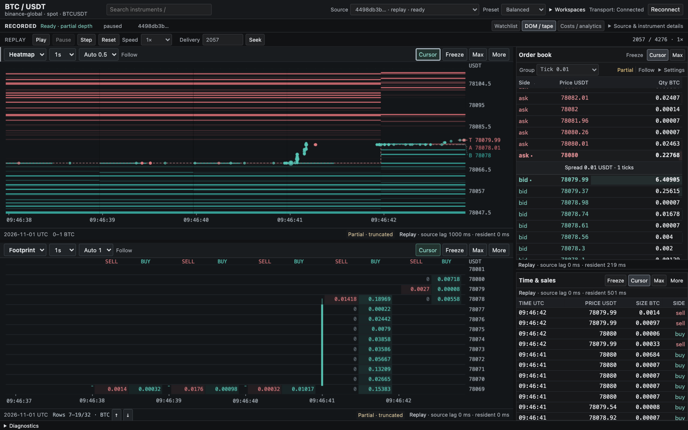

# Crypto Limit Order Book

A local public-market order-flow workstation with an exact Python core and a
React/TypeScript terminal: simultaneous liquidity and footprint/candlestick charts,
an aggregate-L2 depth ladder and independently controlled tape, quality-gated
analytics, size-aware costs, deterministic replay, local alerts, reference context,
spot IOC paper accounting, a durable journal and offline research. Charts share
one exact instrument while keeping independent view settings and native queries.
The supported Streamlit dashboard is a thin native-API observation client, not a
second market-data engine.

[](docs/evidence/m8-after-recorded-1440.png)

*Recorded-source M8 workstation at delivery 2057 / 4276, 1440 × 900 CSS pixels; not a live-feed or latency certification. Click to view full size. The [M8 evidence handoff](docs/OMP_UPGRADE_HANDOFF.md#m8--market-first-workstation) records matched viewport/source provenance and executed verification; the earlier M7 audit remains historical.*

## Upgrade progress

- **M0:** baseline audit, architecture decisions, contracts and acceptance backlog
  recorded. Historical audit observations describe the starting code, not all
  current behavior.
- **M1:** exact core, seven public venue adapters, supervised shared subscription
  ownership and legacy safety fixes implemented and merged. Live feed integrations
  have measured evidence below.
- **M2:** durable raw/normalized capture, verified manifests/checkpoints, deterministic
  replay and an explicitly synthetic offline demo implemented. Integration and
  Git delivery evidence are tracked in the handoff.
- **M3–M4:** native analytics/costs, independent terminal sessions, historical
  liquidity visualization and persistent workspace are implemented. Earlier
  benchmark and capture observations remain historical evidence in the handoff.
- **M5:** native alerts/evidence, Hyperliquid context, paper/journal persistence
  and research CLI/report tabs are implemented. These workflows are simulations
  and analysis, not exchange execution or evidence of profitable signals.
- **M6:** local-only defaults, locked setup, multi-client/restart/fault recovery,
  a complete30-minute Binance-global/Hyperliquid capture with full replay parity,
  and measured native/rendering behavior. Evidence includes failed attempts,
  bootstrap/tail-latency limits and the explicitly unrun24-hour soak.
- **M7:** the dedicated order-flow workstation redesign is implemented: independent
  primary/secondary chart views, exact source-time/price cursor links, four
  maximizable market panes, browser-local workspace slots, independent tape
  controls, watchlist/research drawers and pinned identity, quality and freshness
  evidence. Source-clock lag, browser evidence residency and rendering/ACK
  measurements remain distinct. Implementation is not a gate result: current
  verification and visual evidence belong in the
  [delivery/evidence handoff](docs/OMP_UPGRADE_HANDOFF.md).
- **M8:** the market-first workstation adds native receive-clock date/time labels,
  readable numeric footprints, compact responsive pane controls and exact
  DOM/print inspection. Cursor linking and optional chart-time navigation are
  independent; follow, fit and recenter have separate meanings. Keyboard
  navigation, layout presets and prioritized incidents retain access to exact
  evidence without turning transport health into market-data quality. See the
  [M8 handoff](docs/OMP_UPGRADE_HANDOFF.md#m8--market-first-workstation)
  for implementation scope and source-specific evidence.

For current acceptance status and executed evidence, see the
[operational readiness and recovery](docs/READINESS.md),
[full acceptance backlog](docs/UPGRADE_BACKLOG.md),
[delivery/evidence handoff](docs/OMP_UPGRADE_HANDOFF.md),
[architecture decisions](docs/ARCHITECTURE.md) and
[exact contracts](docs/CONTRACTS.md). Neither fixture tests nor successful access
probes establish complete live-feed correctness or trading readiness.

## Run the terminal

Use Python 3.13.5, uv 0.8.4 and Node 22.22.0/npm 10.9.4:

```sh
uv sync --locked --python 3.13.5 --group dev
npm --prefix frontend ci
npm --prefix frontend run build
uv run --locked --offline --no-sync python -m src.workstation.cli serve --network
```

Open `http://127.0.0.1:8000/?source=live` for public exchange data. The explicit
`--network` flag enables discovery/collection and makes live the server's preferred
source. Binance global and Hyperliquid remain native, separately qualified feeds.
No durable capture is generated on startup. Health distinguishes process
liveness from synchronized session data.

Omit `--network` for the deliberately sparse, initially paused **synthetic offline
demo**; use **Play synthetic demo** to advance its fixture, not to obtain live
orders. Use `serve --capture data/workstation/SESSION_ID` for verified recorded
replay. A URL source overrides saved preferences; unavailable live data never
silently becomes demo. Do not run a second live collector beside a recorder.
Unknown fees, missing depth, stale inputs and incompatible quotes remain explicit
exclusions. No order is sent to an exchange. See
[terminal controls](docs/TERMINAL.md), [API](docs/API.md),
[analytics](docs/ANALYTICS.md) and [costs](docs/COSTS.md).

The [operator guide](docs/TERMINAL.md) covers independent chart settings, cursor
and time-range links, keyboard navigation/resizing, layout presets, four local
workspace slots and source/diagnostics inspectors. Workspace preferences never
save a mutable backend session. Chart dates project native paired receive clocks;
replay age is measured against its source clock, not today's wall clock. **Fit
time** for flow fits returned native aggregates, not an invented all-history
extent. Compact footprints crop native rows for legibility without regrouping
prices or quantities; exact values remain inspectable.

The visual direction references [Flowsurface](https://flowsurface.com/),
[OpenMarket's footprint guide](https://openmarket.xyz/learn/order-flow/footprint)
and [TradingView's footprint documentation](https://www.tradingview.com/support/solutions/43000726164/):
dense market panes, readable bid/ask numbers and contextual chart controls.
[aggr.trade](https://aggr.trade/) informs tape minimalism, while
[Hyperliquid](https://app.hyperliquid.xyz/) and [Lighter](https://app.lighter.xyz/)
inform the chart/DOM/tape column hierarchy; these are influences, not parity claims.
The terminal and native Canvas renderer are independently implemented; no
reference implementation's code or assets are copied, and no chart package is
adopted. Public-live `analytical_queue_overflow` remains a known collector-capacity
boundary, not something the frontend redesign or reconnect repairs.

## Local alerts, paper, journal and research

`serve --state-dir data/workstation-state` stores `paper.sqlite3`,
`journal.sqlite3` and `research.sqlite3` under the chosen directory (this is also
the CLI default). Use the same directory for `research run`, `research list`,
`research show` and the server to inspect persisted attempts in the terminal.
See [demo/CLI workflows](docs/DEMO.md) for exact research configuration and
commands, and [API contracts](docs/API.md) for bounded request/response fields.

The terminal's **Alerts**, **Context**, **Paper**, **Journal** and **Research**
tabs consume native results. Alert thresholds have explicit units, hysteresis,
cooldown and supporting evidence; they are not forecasts. Hyperliquid mids,
mark/oracle, funding and open interest are reference-only. USD, USDT and USDC
remain distinct identities; missing FX or fees remain unknown.

Paper requires explicit venue/asset funds, dated fee assumptions and feed,
decision and order latencies. Only spot market/marketable-limit IOC is modeled:
partial fills cancel the remainder, consumed depth cannot be reused without
observed replenishment, and neither passive fills nor market impact is inferred.
Initial inventory cost basis is unknown. Archives preserve accounting evidence;
they do not silently become the active replay ledger. Resume is explicit,
source-matched and unavailable for live histories. Journals preserve authored
provenance; research reports retain failed attempts and all candidate outcomes.
Interrupted mutations may already have committed: inspect native state before
retrying; the client does not retry workflow mutations automatically.

## New headless feeds

The new backend is independent of Streamlit rendering. Run an explicit public
network probe (not a recorder and not an execution client):

```sh
uv run --locked python tools/probe_feeds.py --live --duration 60 --include-hype
```

Observed integration evidence, not blanket regional-access guarantees:

| Venue | Actual validation | Limitation |
| --- | --- | --- |
| Binance global | BTC/ETH/SOL metadata, REST depth/trades, synchronized diff books and live trades on official data-only hosts | Preferred over US only when required dependencies work |
| Coinbase | BTC/ETH/SOL Advanced Trade REST snapshots, full WS books and live trades | Public Advanced Trade schema; not the legacy Exchange REST API |
| Kraken | BTC/ETH/SOL REST snapshots, CRC-validated WS books and live trades | REST has no WS continuity/checksum claim |
| Hyperliquid | BTC/ETH/SOL/HYPE perpetual REST snapshots, bounded WS replacement books and live trades | No exact event OFI or invented depth beyond the subscription |
| Binance.US | BTC/ETH/SOL REST and partial WS books; ETH/SOL live prints | BTC produced no live print in the short observation window; distinct venue |
| KuCoin | BTC/ETH/SOL REST books and trade history | Degraded snapshots; unknown aggressor side, not continuous WS |
| Bybit | Offline protocol/reset fixtures | Metadata HTTP 403 blocked this machine; remaining live checks unrun |

The initial failed run and corrected run are retained in
[`docs/evidence/`](docs/evidence/); see [feed validation](docs/FEED_VALIDATION.md)
for exact commands and [contracts](docs/CONTRACTS.md) for loss, freshness,
ownership and source-transition semantics. No fixture data fills gaps in live
history. Streamlit uses the same native API as the React terminal, without
separate exchange collectors or financial formulas.

## Record, replay and offline demo

After the locked Python setup below:

```sh
# Offline: original CC0 synthetic BTC/ETH/SOL scenarios, 180 virtual seconds.
uv run --locked python -m src.workstation.cli demo

# Actual public data; both venues retain distinct market/quote identities.
uv run --locked python -m src.workstation.cli record --network \
  --venue binance-global --venue hyperliquid --assets BTC ETH SOL --duration 60

# Replace SESSION_ID with the capture directory reported by either command.
uv run --locked python -m src.workstation.cli inspect data/workstation/SESSION_ID
uv run --locked python -m src.workstation.cli replay data/workstation/SESSION_ID --mode raw
uv run --locked python -m src.workstation.cli replay data/workstation/SESSION_ID --interactive
```

Interactive replay supports `play SPEED`, `pause`, `step N`, `seek ORDINAL`,
`run` and `quit`. Raw and normalized paths share reconstruction and quality rules.
Incomplete/corrupt captures are not silently accepted. The recorder owns its
subscription leases independently of browser clients; capture starts before
synchronization, and CLI readiness labels that distinction.

The terminal's memory-backed demo and the `demo` command's durable capture
are separate workflows; neither represents historical exchange activity.
See [recording](docs/RECORDING.md), [replay](docs/REPLAY.md), [demo/CLI](docs/DEMO.md)
and the handoff for exact evidence, budgets, recovery and source limitations.

## Run the supported Streamlit client

Use the same locked Python 3.13 environment as the native backend. In one
terminal, start the offline synthetic demo API:

```sh
uv run --locked --offline --no-sync python -m src.workstation.cli serve
```

In another terminal:

```sh
uv run --locked --offline --no-sync python -m streamlit run crypto_lob.py --server.address 127.0.0.1
```

Streamlit connects only to a loopback API origin. Select a catalog source and
exact native instrument, then open the selection. It shares the backend's
metadata, books, quality, historical grids, analytics and cost engine with the
React terminal; it has no separate exchange collectors or financial formulas.
Each browser document owns an independent API session. Live feed leases remain
shared by the native registry, not by Streamlit process-global resources.

The default is synthetic and offline. Recordings require `serve --capture`;
public live data requires explicit `serve --network`. Unknown fees, incompatible
quotes, invalid books and incomplete flow remain visible, not zero or profit.
See [legacy client operation and bounds](docs/LEGACY.md), [API](docs/API.md) and
[native development](docs/DEVELOPMENT.md). No credentials or wallet are required.

## Repository layout

- `crypto_lob.py`, `src/ui/`: thin Streamlit observation client of the native API.
- `frontend/`: React/TypeScript order-flow workstation and independent native Canvas chart panes.
- `src/workstation/`: exact core, public adapters, shared feed registry,
  recording/replay, analytics, visualization, alerts/context, paper/journal,
  research and versioned terminal API.
- `tests/`: offline contracts/regressions and explicitly separate live checks.
- `docs/`: development instructions, contracts, acceptance and evidence.

## Checks and live access

After synchronizing the environment, use the documented offline gate:

```sh
./tools/check.sh
```

The gate and its environment-selection rules are explained in
[DEVELOPMENT.md](docs/DEVELOPMENT.md#offline-checks-and-quality-scope).
Public live probes and recordings use the explicit native CLI `--network`
commands above; the duplicate legacy smoke script and collectors are retired.
Executed checks, access observations and remaining blockers belong in the
[handoff](docs/OMP_UPGRADE_HANDOFF.md), not inferred pass counts in this README.

Public endpoints may rate-limit, block regional access, suspend products or
change their protocols. This is an educational/research project, not trading
advice. No live order execution, private credentials, signing or withdrawals are
implemented or authorized by this upgrade.
