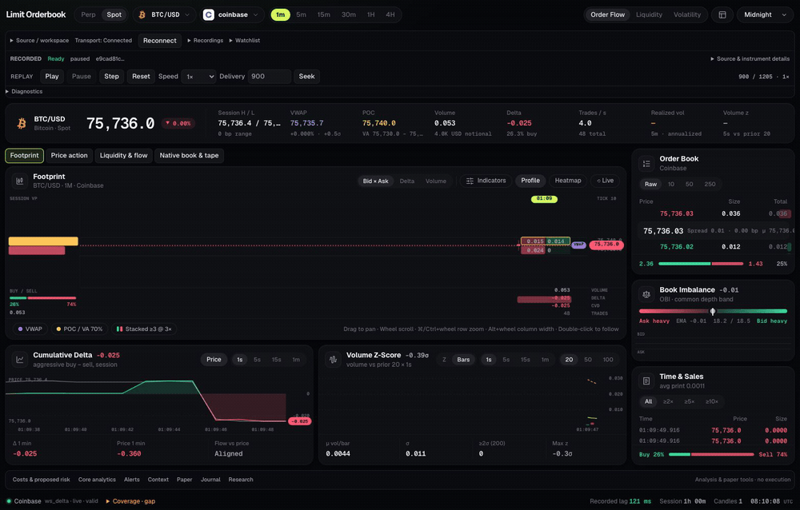

# Crypto Limit Order Book

A crypto order-flow terminal with **one Python-backed session** for public market
data, exact analytics, historical charts, recording/replay and local research
workflows. The footprint, book, tape and studies share the same source and native
instrument as the integrated chart and workflow tools. No exchange order is sent.

[](docs/media/orderbook-demo.mp4)

[Watch the 94-second walkthrough (MP4)](docs/media/orderbook-demo.mp4): actual
Binance BTC/USDT public-market replay showing footprint modes, CVD and volume
bars, depth, replay candles, native liquidity, book/tape and exact cost estimates.
A larger highlighted pointer, subtle halo and short click pulses make the
interactions easy to follow; these overlays exist only in the recording.
The animated preview links to the full video. This bounded spot replay demo is
not proof of perpetual workflows, all-provider correctness, latency,
sustained capacity or trading readiness.

## Terminal features

- Six themes, **Order Flow / Liquidity / Volatility** presets, panel visibility
  and draggable panel borders.
- **Bid × Ask / Delta / Volume** footprints; session profile, executed-volume
  heatmap, VWAP deviation bands, POC/value area and stacked imbalances.
- One reference-style book/tape surface with explicit native exact inspection;
  raw/grouped books, primary or consolidated depth, size-filtered tape, CVD,
  volume z-score, depth/imbalance and realized-volatility studies.
- Spot/perpetual market selection, searchable instruments, venue selection and
  indicative cross-venue aggregates, all supplied by the native backend.
- **Footprint / Price action / Liquidity & flow / Native book & tape** chart
  tabs, exact book/print inspection and source/quality diagnostics.
- Exact costs and proposed-risk scenarios, core analytics, alerts/evidence,
  Hyperliquid context, spot IOC and isolated perpetual paper accounting,
  journal and read-only research.
- Source switching, replay controls, managed recording and browser-local
  workspace preferences in the same terminal—not a separate application.

### Public crypto coverage

| Provider | Native markets |
| --- | --- |
| Binance | Spot and USDT USDⓈ-M perpetuals |
| Bybit | Spot and USDT linear crypto perpetuals |
| OKX | Spot and linear perpetual swaps |
| Bitget | Spot and USDT perpetuals |
| Coinbase | Spot |
| Hyperliquid | Perpetuals |
| Deribit | BTC/ETH inverse perpetuals |
| Binance.US, Kraken, KuCoin | Spot |

The source catalog determines available instruments. Discovery, live books,
trades and historical candles have provider-specific coverage and quality;
listing an adapter does not certify every symbol, region or channel. Public
endpoints may rate-limit, restrict access or change protocols. Derivative
contract units and settlement remain explicit; perpetual paper support requires
verified pinned financial metadata and explicit risk/funding assumptions. See
[feed validation](docs/FEED_VALIDATION.md)
for historical observations, not blanket qualification of this release.
Discovery excludes Bybit linear TradFi classifications and Bitget RWA futures;
native crypto contract metadata remains explicit.

The live terminal starts Binance and Bybit subscriptions from a bundled crypto
candidate catalog without waiting for REST metadata. Official spot/perpetual
metadata loads independently; REST restrictions do not imply WebSocket failure.
Candidates are explicitly **streaming-only**, not confirmed listings: tick, lot
and order limits remain unknown. Catalog candidates, observed books, retained
ordered prints and verified financial metadata are separate readiness signals.
Display studies and recording/replay remain available; exact costs, comparison,
proposed risk and paper orders require verified session-pinned metadata.
Successful discovery enriches future streams without rewriting existing captures.
No precision is fabricated and no other exchange is silently substituted.
The UI calls the venue **Binance**; native IDs retain `binance-global`.
Bybit uses the [official equivalent mainnet host](https://bybit-exchange.github.io/docs/v5/guide)
`api.bytick.com`; regional restrictions still apply. See
[native adapter access semantics](docs/ADAPTERS_ASIAN.md#metadata-and-identity).

Aggregate display prices can combine USD/USDT/USDC **without conversion** and
are indicative, not executable arbitrage prices. The primary native instrument
and exact quote identity remain authoritative for costs and paper workflows.
Other quote currencies are not mixed into that dollar-family display. Each
venue/market contributes one native instrument; outside that family, aggregates
require the same exact quote identity.
Missing conversion evidence or fees stay unknown; display-only studies do not
replace native quality-gated financial results. No missing history is fabricated.

## Run the terminal

Use Python 3.13.5, uv 0.8.4 and Node 22.22.0/npm 10.9.4:

```sh
uv sync --locked --python 3.13.5 --group dev
npm --prefix frontend ci
npm --prefix frontend run build
uv run --locked --offline --no-sync python -m src.workstation.cli serve --network
```

Open `http://127.0.0.1:8000/`. Python serves the built frontend and owns public
exchange connections; no frontend keys or environment file are needed.
`--network` explicitly enables native discovery/collection and makes live the
server-preferred source. Starting the server does not start durable recording.

Omit `--network` for the initially paused **synthetic offline demo**. Playing it
advances fixtures, not real orders. Use `serve --capture data/workstation/SESSION_ID`
to expose an existing verified capture as a replay source. Select sources inside
the terminal, or request a catalog source with `/?source=live` or
`/?source=<catalog ID>`. A URL source takes precedence over saved preferences;
unavailable live data never silently becomes demo.

For development, keep the Python server running and start
`npm --prefix frontend run dev`; open `http://127.0.0.1:5173/`. Vite proxies the
native API and WebSocket to port 8000. It is not a standalone exchange client.
Each browser document owns an independent session; feed subscriptions may be
shared by the backend, but selections and replay cursors are not shared.

See [terminal controls](docs/TERMINAL.md), [development](docs/DEVELOPMENT.md),
[API](docs/API.md), [analytics](docs/ANALYTICS.md) and [costs](docs/COSTS.md).

## Charts, recording and replay

**Price action**, the footprint and trade studies use admitted native trades in
live, synthetic demo and replay, for spot and perpetuals. They share the actual
selected native cohort and one persisted interval: **1m, 3m, 5m, 15m, 30m, 1h,
2h, 4h, 6h, 8h, 12h, 1d, 3d, 1w, 1M**. Fixed buckets use Unix-epoch UTC
alignment (weeks start Thursday); `1M` is a UTC calendar month.

Price Action uses the source's exact receive-wall anchor plus matching
receive-monotonic delta, not browser time or exchange execution time. Retained
history and response limits are disclosed; subscription-history prints and
unknown base sizes do not become candle volume. No future or empty candles are
invented. A closed bucket means its time boundary passed, not complete coverage.
**Venue history** (`venue_ohlcv`) is an explicit, separate primary-only historical
source where supported, never an automatic backfill or substitute for aggregate
session bars.

Normal chart views retain one reference-style book/tape sidebar. **Native book
& tape** replaces it with exact inspection rather than opening a duplicate
sidecar. Single-book mode never substitutes aggregate depth for a missing primary;
all depth is bounded observed coverage. Book presence alone does not establish
retained-print readiness.

Changing the shared interval recomputes retained inputs without creating a new
financial session or changing replay speed. Trade-stream continuity/retention
boundaries retire affected trade evidence without discarding independent depth
history. Busy workflow actions pause display polling without clearing same-owner
caches. Missing timestamp evidence shows unavailable lag; **Recorded lag**
describes capture-time receipt, not playback latency.

Open **Recordings** and choose one of exactly two capture scopes:
**Selected instrument** (`instrument`, default) captures all primary-owned
channels, including book/trades and any reference/context streams;
**Session cohort** (`cohort`) captures all native session-owned keys.
Default capture does not require unrelated cohort channels. Scope and keys are
fixed at start; display selection changes do not retarget recording. Rows retain
scope, instrument IDs and channel metadata across restarts. The server chooses
paths under `--state-dir`; browser clients never supply filesystem paths.
**Stop recording** finalizes and validates; completed usable captures offer
**Replay recording** without restarting the server. **Refresh recordings**
exposes status and incomplete/error reasons. Missing evidence or incomplete
captures are not made complete by scope choice or successful finalization.
Session/server close finalizes capture; restart rediscovers verified recordings
from retained state. Limits are two active captures per server (one per session),
64 retained entries and 128 MiB per capture.

Replay play/pause, step, speed, delivery-index seek and reset control the actual
native replay engine. Seek/reset and source changes invalidate obsolete chart
and workflow evidence. Chart freezes hold presentation only; they do not pause
collection, recording or the replay clock.

Headless workflows remain available:

```sh
# Explicitly synthetic, original CC0 scenarios; not exchange history.
uv run --locked python -m src.workstation.cli demo

# Actual public data with distinct venue/market/quote identities.
uv run --locked python -m src.workstation.cli record --network \
  --venue binance-global --venue hyperliquid --assets BTC ETH SOL --duration 60

# Use the capture directory reported by demo or record.
uv run --locked python -m src.workstation.cli inspect data/workstation/SESSION_ID
uv run --locked python -m src.workstation.cli replay data/workstation/SESSION_ID --mode raw
uv run --locked python -m src.workstation.cli replay data/workstation/SESSION_ID --interactive
```

Interactive replay supports `play SPEED`, `pause`, `step N`, `seek ORDINAL`,
`run` and `quit`. Raw and normalized replay share reconstruction/quality rules;
incomplete or corrupt captures are not silently accepted. See
[recording](docs/RECORDING.md), [replay](docs/REPLAY.md) and [demo/CLI](docs/DEMO.md).

## Exact local workflows and limits

`serve --state-dir data/workstation-state` selects durable storage (also the CLI
default), including paper, journal, research and managed captures. Use the same
directory for `research run`, `research list`, `research show` and the server.
Research reports retain configuration, exclusions, failed attempts and all
candidate outcomes; the browser does not launch experiments or tune parameters.
The [strategy research backlog](docs/STRATEGY_RESEARCH.md) contains hypotheses,
not validated strategies.

Alerts have explicit units, hysteresis, cooldown and supporting native evidence;
they are not forecasts. Hyperliquid mids, mark/oracle, funding and open interest
are reference-only. Price Action can plot the observed open interest and funding
history under price on the same time axis (**OI & funding**). USD, USDT and USDC remain distinct identities; missing
quote-conversion evidence, fees, depth or eligible history stay explicit.

Paper requires explicit venue/asset funds, dated fees, and feed, decision and
order latencies. Spot **market/marketable-limit IOC** remains available; supported
native perpetuals use a one-way isolated ledger with exact settlement collateral,
native quantities, user-sourced leverage/maintenance/liquidation-fee assumptions
and an explicit funding model (including an explicitly chosen no-funding model).
Buy/sell can open long/short or close opposite exposure; reduce-only cannot add
or flip exposure. The drawer exposes margin, realized/unrealized P&L, fees,
funding, protective liquidation, residual exposure and debt. Book-side marks are
proxies, not exchange marks or guaranteed liquidation prices.

IOC remainders cancel; consumed depth requires observed replenishment. No
passive fills, borrowing or market impact is inferred. Spot initial-inventory
cost basis stays unknown. A funding-accounting limit freezes paper at its last
valid prefix without stopping charts; recovery is explicit, never a silent
skip of funding. Archives remain read-only and survive retained-state restart.
Resume reconstructs a matching demo/replay prefix, not a live history; changing
historical intent requires an explicit fork with entered starting funds. See
[paper controls and limits](docs/TERMINAL.md#paper-workflow-spot-and-isolated-perpetuals).

Journals preserve authored provenance. Interrupted workflow mutations may already
have committed: inspect native state before retrying. The client does not
retry mutations automatically. No credentials, wallet/signing, private exchange
operations or live execution are provided.

## Repository and evidence

- `frontend/`: unified React/TypeScript terminal, display studies and native chart/workflow integration.
- `src/workstation/`: exact core, public adapters, shared feed registry,
  recording/replay, analytics, visualization, alerts/context, paper/journal,
  research and versioned terminal API.
- `crypto_lob.py`, `src/ui/`: supported thin Streamlit observation client of the
  same API; see [legacy client operation](docs/LEGACY.md).
- `tests/`: offline contracts/regressions and separately opted-in live checks.
- `docs/`: development instructions, contracts, acceptance and historical evidence.

After synchronizing dependencies, `./tools/check.sh` is the documented offline
gate; see [development](docs/DEVELOPMENT.md#offline-checks-and-quality-scope).
For deliberate public-service observations, use
`uv run --locked python tools/probe_feeds.py --live --duration 60 --include-hype`.

Executed checks and known limits belong in the
[delivery/evidence handoff](docs/OMP_UPGRADE_HANDOFF.md),
[operational readiness](docs/READINESS.md), [acceptance backlog](docs/UPGRADE_BACKLOG.md)
and [exact contracts](docs/CONTRACTS.md). Historical results are not certification
of current changes. Fixture success and finite live probes do not establish
all-symbol correctness, a long-running soak, sustainable capacity or trading
readiness. This is an educational/research project, not trading advice.
