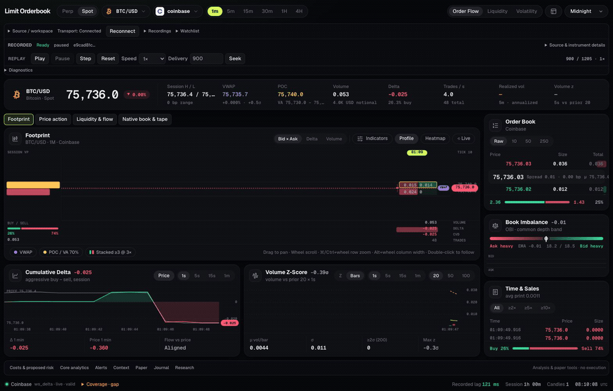

# Crypto Limit Order Book

A local crypto order-flow terminal for public market data, exact analytics,
recording/replay and simulated trading. Each browser document owns an independent
Python-backed session; exchange feeds may be shared. React renders the charts and
controls, while the native backend owns financial calculations and evidence.
No exchange order is sent.

**Start here: [Quickstart and operating manual](docs/QUICKSTART.md)** — startup,
updates, every major view, recording/replay, paper safety and recovery.
The [stabilization review](docs/STABILITY_REVIEW.md) records measured problems,
repairs, local verification and operating limits; it is not live-execution certification.

[](docs/media/orderbook-demo.mp4)

[Watch the 2-minute 15-second walkthrough (MP4)](docs/media/orderbook-demo.mp4).
Six captioned chapters show recorded public **Hyperliquid BTC perpetual** data
with synchronized price/OI/funding, shared intervals, footprint modes, liquidity
and linked native book inspection. A clearly labeled **synthetic sandbox** then
demonstrates spot/perpetual scope, indicative aggregates, explicit paper models,
funding payments, reduce-only closing, archived audits and exact replay.

The 23-second animated preview links to the full video. Paper collateral, fees,
risk and the accelerated **60-second funding schedule** are explicit simulation
assumptions—not account funds or observed exchange funding. This bounded replay
walkthrough is not a guarantee of provider availability, sustained capacity,
latency or trading readiness.

## Terminal features

- **Footprint, Price action, Liquidity & flow, Native book & tape** workspaces,
  six themes, five presets, named editable grids and keyboard-accessible inspection.
- Bid × Ask / Delta / Volume footprints, VWAP, POC/value area, volume profiles,
  CVD, volume z-score, depth/imbalance and realized-volatility studies.
- Spot/perpetual selection, grouped native-instrument search, exact price pins
  and explicitly indicative cross-venue displays.
- Lightweight Charts **5.3.0** price/volume, one global timeframe selector,
  paginated ticker history and optional clock-compatible observed **OI & funding**.
- Optional historical resting-liquidity footprint layer and individual
  large-print venue badges, distinct from executed-volume heatmaps.
- Native costs/proposed risk, alerts, reference context, **spot IOC and isolated
  perpetual paper accounting**, a manual journal and read-only research reports.
- Managed recording, causal replay, durable paper archives and browser-local
  workspace preferences.

### Public crypto coverage

| Provider | Native markets |
| --- | --- |
| Binance | Spot and USDT USDⓈ-M perpetuals |
| Bybit | Spot and USDT linear crypto perpetuals |
| OKX | Spot and linear perpetual swaps |
| Bitget | Spot and USDT perpetuals |
| Coinbase | Spot |
| Hyperliquid | Spot and perpetuals |
| Deribit | BTC/ETH inverse perpetuals |
| Binance.US, Kraken, KuCoin | Spot |

Adapter support is not a guarantee of symbol, channel or regional availability.
Discovery, observed books/trades and verified financial metadata are separate
readiness signals. Binance and Bybit can start public subscriptions from
**streaming-only candidates** while official metadata is unavailable; this does
not invent tick/lot rules or enable financial operations. Costs and paper require
verified session-pinned metadata and their own quality/economic checks.

USD, USDT and USDC remain distinct. Dollar-family display aggregates may combine
quotes **without conversion**, but are indicative—not executable spreads or
paper-order prices. Wrapped assets are not automatically equivalent to their
underlyings. See [provider coverage](docs/FEED_VALIDATION.md),
[metadata/access rules](docs/ADAPTERS_ASIAN.md#metadata-and-identity) and
[native quote/FX costs](docs/COSTS.md).

## Run the terminal

Use Python 3.13.5, uv 0.8.4 and Node 22.22.0/npm 10.9.4:

```sh
uv sync --locked --python 3.13.5 --group dev
npm --prefix frontend ci
npm --prefix frontend run build
uv run --locked --offline --no-sync python -m src.workstation.cli serve --network
```

Open `http://127.0.0.1:8000/`. Python serves the built frontend and owns public
exchange connections; no frontend keys or environment file are needed.
`--network` explicitly enables native discovery/collection and makes live the
server-preferred source. Starting the server does not start durable recording.

Omit `--network` for the initially paused **synthetic offline demo**. Playing it
advances fixtures, not real orders. Use `serve --capture data/workstation/SESSION_ID`
to expose an existing verified capture as a replay source. Select sources inside
the terminal, or request a catalog source with `/?source=live` or
`/?source=<catalog ID>`. A URL source takes precedence over saved preferences;
unavailable live data never silently becomes demo.
Explicit **Ticker history** (`venue_ohlcv`) requests may fetch public REST candles
even without `--network`; that flag controls shared live discovery/collection.

For development, keep the Python server running and start
`npm --prefix frontend run dev`; open `http://127.0.0.1:5173/`. Vite proxies the
native API and WebSocket to port 8000. It is not a standalone exchange client.
Each browser document owns an independent session; feed subscriptions may be
shared by the backend, but selections and replay cursors are not shared.

See [terminal controls](docs/TERMINAL.md), [development](docs/DEVELOPMENT.md),
[API](docs/API.md), [analytics](docs/ANALYTICS.md) and [costs](docs/COSTS.md).

## Charts, recording and replay

Price action uses a hybrid renderer: Lightweight Charts **5.3.0** for candles,
volume and compatible optional panes; specialized footprint/liquidity charts
retain their native rendering and exact inspectors. **Auto** source selects
**Ticker history** for live sessions and **Observed flow** for demo/replay.
Ticker history is one exact primary instrument on exchange time; observed flow
uses the selected native cohort on projected receive time. They are never
stitched together or silently substituted.
Ticker requests are independent of observed-cohort/collector readiness, while
session/source/generation fences remain enforced. A current ticker chart is not
proof that observed books/trades or financial workflows are healthy.

One persisted global interval runs from **1m through calendar-month 1M**, subject
to each provider's supported intervals. Scroll left for older ticker pages;
updates use labeled **5-second polling**, not candle streaming. Auto/Log scale,
Fit loaded history, Latest/follow and a right margin control navigation.
Mounted history is capped at **10,000 bars**; reaching the cap preserves loaded
history and requires an explicit reset to resume growth, not invisible eviction.
Current external ticker requests during replay are explicitly labeled as
**not replay evidence**. Observed OI/funding remains opt-in and receive-clock
compatible, with its actual supplying instrument and units; absent data does
not reserve blank panes.

Exact original decimal strings drive inspection. The renderer receives an
explicit decimal-power `base` and `minMove`; bounded plotting conversions reject
colliding/unrepresentable values rather than rounding financial evidence.

The responsive desktop grid fits **12 logical rows** to remaining height with a
**24px minimum row height**; custom extents/short windows can scroll and narrow
screens stack panels. Compact one-line desktop KPIs and visible provenance keep
space for the chart. Presets are **Order flow, Price focus, Liquidity, Volatility
and Execution**. Saved layouts dismiss on outside interaction/focus or Escape
without clearing drafts; layouts store display geometry/preferences, not active
source, instrument, cohort or session. Hidden native panes preserve frozen
evidence while query/paint work is suspended.

Optional resting overlays use retained native historical depth, never today's
book stretched backward; large-print badges inspect individual retained trades.
The [implementation and verification record](docs/CHART_REDESIGN_PLAN.md)
tracks the final gates, actual browser observations and known limits.

Finite Binance spot observations include **300→600→900** backfill with the same
normal-precision inspected bar, forming updates and actual hour rollover to
**901** bars, all **18** six-theme/three-width states, continuous touch pan/pinch
interaction and a bounded resource sample.
[Measurements and caveats](docs/CHART_REDESIGN_PLAN.md#recorded-implementation-observations)
do not establish all-provider availability, sustained performance or leak freedom.

Actual implementation screenshots:
[1440 dark](docs/evidence/chart-redesign/live-price-1440-dark.png),
[1440 light](docs/evidence/chart-redesign/live-price-1440-light.png),
[1280 dark](docs/evidence/chart-redesign/live-price-1280-dark.png),
[390 dark](docs/evidence/chart-redesign/live-price-390-dark.png).
**Caption:** live ticker history can remain current while the visible collector
`analytical_queue_overflow` incident leaves observed flow unavailable.
The [synthetic design mockup](docs/media/chart-redesign-mockup.html) is a separate
illustrative layout study, not an implementation screenshot or measured result.

**Recordings** captures either the selected instrument's owned channels or the
session cohort. Scope stays fixed when the display selection changes. Finalized,
verified captures can replay without restarting the server; incomplete captures
remain explicit. Play, pause, step, speed, seek and reset control the native
replay prefix. Freezing a chart does not stop collection or recording.

See [chart contracts and coverage](docs/VISUALIZATION.md),
[operator controls](docs/TERMINAL.md), [capture/recovery](docs/RECORDING.md),
[replay](docs/REPLAY.md) and [headless CLI examples](docs/DEMO.md).

## Exact local workflows and limits

The CLI's default `--state-dir data/workstation-state` retains paper, journal,
research and managed captures. Reuse it for the server and research CLI.

| Capability | Implemented scope and limits |
| --- | --- |
| Spot paper | Explicit prefunded inventory/cash, dated fee assumptions, modeled latency, market/marketable-limit IOC and native cost-basis/P&L accounting |
| Perpetual paper | Supported pinned native contracts; one-way isolated positions, long/short and reduce-only orders, modeled leverage/margin/funding, protective liquidation, residual debt and exact settlement accounting |
| Archives and resume | Durable read-only audits; explicit reconstruction of matching demo/replay prefixes, not automatic adoption of old live accounts |
| Research | Offline chronological, purged/embargoed experiments with retained outcomes and cost/latency stress; independent unfunded observations, not a portfolio backtest or trading strategy runner |

Paper risk/funding models are user assumptions, not exchange risk tiers or
automatically charged observed funding. Marks are conservative book-side proxies.
No passive queue-position fills, borrowing or market impact is inferred.
Analytical continuity loss freezes affected paper accounting at its last complete
prefix with durable gap evidence. Fresh books or reconnecting cannot repair the
missing path or thaw that run; an explicit new run establishes a new boundary.
Unknown fees, conversion evidence and missing depth stay unavailable, not zero.
See [paper controls and boundaries](docs/TERMINAL.md#paper-workflow-spot-and-isolated-perpetuals),
[accounting contracts](docs/CONTRACTS.md) and
[strategy research status](docs/STRATEGY_RESEARCH.md).

**Not implemented:** private exchange execution, wallets/signing/withdrawals,
automated market making, a funding-arbitrage strategy or a Rust HFT engine.
Alerts are evidence-backed conditions, not validated forecasts. Research ideas
and simulated accounting do not establish a profitable or executable strategy.

## Repository and evidence

- `frontend/`: unified React/TypeScript terminal, display studies and native chart/workflow integration.
- `src/workstation/`: exact core, public adapters, shared feed registry,
  recording/replay, analytics, visualization, alerts/context, paper/journal,
  research and versioned terminal API.
- `crypto_lob.py`, `src/ui/`: supported thin Streamlit observation client of the
  same API; see [legacy client operation](docs/LEGACY.md).
- `tests/`: offline contracts/regressions and separately opted-in live checks.
- `docs/`: development instructions, contracts, acceptance and historical evidence.

After synchronizing dependencies, `./tools/check.sh` is the documented offline
gate; see [development](docs/DEVELOPMENT.md#offline-checks-and-quality-scope).
For deliberate public-service observations, use
`uv run --locked python tools/probe_feeds.py --live --duration 60 --include-hype`.

Executed checks and known limits belong in the
[stabilization review](docs/STABILITY_REVIEW.md),
[delivery/evidence handoff](docs/OMP_UPGRADE_HANDOFF.md),
[operational readiness](docs/READINESS.md), [acceptance backlog](docs/UPGRADE_BACKLOG.md)
and [exact contracts](docs/CONTRACTS.md). Historical results are not certification
of current changes. Fixture success and finite live probes do not establish
all-symbol correctness, a long-running soak, sustainable capacity or trading
readiness. This is an educational/research project, not trading advice.
